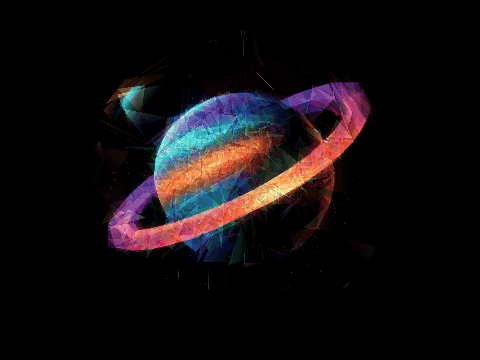
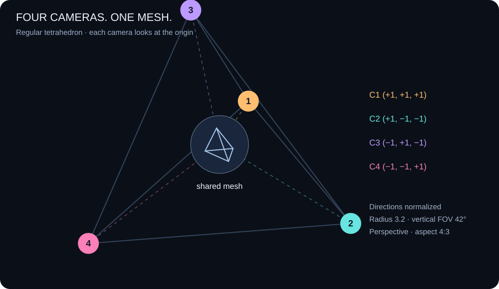
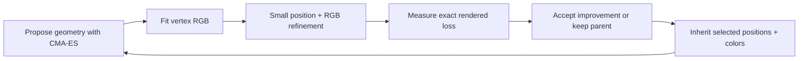

# Lisa2

### A memetic evolution of LisaGA

**Four images. One mesh. Turn the camera and watch the picture change.**

Lisa2 builds on [LisaGA](https://github.com/mgeorgoulopoulos/LisaGA), extending
the idea from two images to four. One colored triangle mesh forms a different
image from each corner of a tetrahedron. A desktop application lets you evolve
the mesh, compare results and explore it in 3D.


*Top: target artwork. Bottom: four renders of the same 768-triangle mesh.*

## See the illusion



Move between the four viewpoints to reveal the triangles behind the illusion.
The animation renders one saved mesh along the preview's orbit-and-dive path.

## Four viewpoints, one object



Four fixed perspective cameras look toward the same central mesh. Each triangle
has RGB vertex colors with smooth Gouraud shading. Triangles are two-sided and
**additive on black**, with no depth testing or textures. Positions and colors
are shared across all views.

## Why memetic?

Evolution searches geometry. Two separate optimization passes improve its
proposals before selection:



1. **Propose geometry.** CMA-ES moves the three vertices of one triangle while
   keeping the rest of the mesh fixed.
2. **Fit color.** With geometry fixed, image colors are linear in vertex RGB.
   Bounded least squares finds colors that improve the four views together.
3. **Refine locally.** Small position changes and color refits seek a further
   improvement. Each change is checked against the actual rendered loss.

The original triangle remains available if a proposal fails to improve it.
Selected positions and colors are inherited by the mesh and feed back into the
evolutionary search. After each full cycle, a global pass refits all vertex colors.

Fitness measures RGB reconstruction error, with a smaller penalty for light
spilled onto black. It reports improvement over an all-black image, not a
percentage of perceptual similarity.

## Run Lisa2 Studio

For ready-to-run builds, open [the latest release](https://github.com/mgeorgoulopoulos/lisa2/releases/latest):

- [Windows installer](https://github.com/mgeorgoulopoulos/lisa2/releases/latest/download/Lisa2-Windows-Setup.exe)
- [Windows portable ZIP](https://github.com/mgeorgoulopoulos/lisa2/releases/latest/download/Lisa2-Windows-Portable.zip)
- [Linux x86-64 portable bundle](https://github.com/mgeorgoulopoulos/lisa2/releases/latest/download/Lisa2-Linux-x86_64.tar.gz)

The packages include Python. On Linux, extract and run `./Lisa2/start.sh`
(Ubuntu 22.04+ baseline). Windows packages are unsigned.
See [distribution details](docs/DISTRIBUTION.md) for requirements and automatic builds.

Or clone and run directly from source. Install **Python 3.12** once (with Tk;
Linux also needs its matching venv package), then:

```powershell
git clone https://github.com/mgeorgoulopoulos/lisa2.git
cd lisa2
.\Lisa2.bat
```

On Linux, run `bash Lisa2.sh` instead. The launcher creates `.venv` and installs
dependencies on first launch. Later runs reuse it. Internet is needed for setup
and dependency updates.

Drop four images into the slots, press **Start evolution**, and choose a project
filename. Watch the target/reconstruction tiles and the full fitness history.
Stop whenever you want, then load the project later and resume where it stopped.

| Feature | What it gives you |
|---|---|
| Search modes | Evolution only, exact vertex-color fitting, or local position-and-color refinement |
| Configurable mesh | **768 triangles** by default |
| Target resolution | **640×480** by default; configurable width with fixed 4:3 aspect |
| Automatic stopping | Optional plateau detection across completed cycles |
| Project persistence | Small JSON plus companion data folder; complete fitness and proposal histories |
| Live preview | Four checkpoint images and a separate 3D view; keys **1–4** select the target cameras |
| Statistics | Loss terms, proposal counts, accepted updates and CSV export |
| OBJ export | Vertex RGB, rendering sidecars and exact camera definitions in header comments |
| GIF export | Orbit and camera dive from a consistent checkpoint snapshot |

Keep a project JSON **together with its companion data folder**.
Detailed controls and settings: [Studio guide](STUDIO.md).

## Choose images the mesh can represent

Choose strong silhouettes and large, smooth color regions. Leave black margin
around the subject and use coherent palettes across the four targets. Fine
textures and small lettering are difficult to reproduce with a limited mesh.

## Experiments

The reports describe methods, measurements and their limits:

- [Inherited refinement and parameter screening](BALDWIN_PLUS_EXPERIMENT.md)
- [Runtime, convergence and matched-fitness measurements](TIMING_EXPERIMENT.md)
- [Triangle-replacement pilot](REPLACEMENT_EXPERIMENT.md)
- [Research directions and prior art](RESEARCH_DIRECTIONS.md)
- [Legacy CLI and experiment notes](docs/LEGACY_CLI.md)

## Repository contents

`lisa2/` contains the Studio, CPU renderer and optimizers. Tests live in `tests/`.
Local images, experiment runs and virtual environments are excluded from Git.
Use your own four images to start a project.

```powershell
.venv\Scripts\python.exe -m tests.check_obj_cameras
.venv\Scripts\python.exe -m tests.check_dimensions
.venv\Scripts\python.exe -m tests.check_studio
```

## License

[MIT](LICENSE) — Copyright © Michael Georgoulopoulos.
Bundled third-party dependencies retain their respective licenses.
