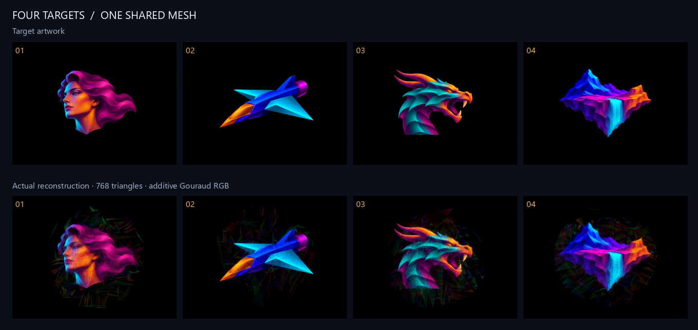
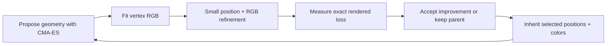

# Lisa2

### A memetic evolution of LisaGA

**Four images. One mesh. Turn the camera and watch the picture change.**

Inspired by [the original LisaGA by Michael Georgoulopoulos](https://github.com/mgeorgoulopoulos/LisaGA),
which reconstructs two images from an additively rendered triangle mesh,
Lisa2 searches for a single colored triangle mesh that forms four different
images when viewed from the corners of a tetrahedron. It combines evolutionary
geometry search, bounded vertex-color fitting and a small inherited local
refinement step, with a desktop application for running experiments.



*Top: target artwork. Bottom: actual software renders of one 768-triangle
checkpoint. These are approximate reconstructions: visible spill and missing
detail are part of the result, not retouched away.*

## See the illusion


The animation uses the actual preview camera path and saved mesh. Between the
four target views, the triangles reveal the structure behind the illusion.
It is a camera movement through one model, not a crossfade between images.

## Four viewpoints, one object


The camera directions are the normalized vectors `(1,1,1)`, `(1,-1,-1)`,
`(-1,1,-1)` and `(-1,-1,1)`. Each camera sits at radius **3.2**, looks at the
origin, and uses a **42° vertical field of view** with a **4:3** aspect ratio.
The diagram is explanatory; its center mesh symbol is not the evolved model.

Every triangle lives inside the unit ball. It has three independent RGB vertex
colors, interpolated with affine screen-space Gouraud shading. Contributions
are **additive on black**, with two-sided triangles and no depth testing.
There are no textures, per-view colors or hidden image planes. All four images
must emerge from the same positions and colors.

## Why memetic?

Evolution searches geometry, while local optimization improves each proposal
before selection. The default pipeline keeps two optimization passes separate:



1. **Propose geometry.** CMA-ES proposes three vertex positions for one triangle,
   keeping the other triangles fixed. All four views contribute to evaluation.
2. **Fit color.** For fixed positions, rendered RGB is linear in the vertex
   colors. Bounded least squares fits all nine RGB values against the residual
   of the other triangles, with each channel bounded to `[0, 0.4]`.
3. **Refine locally.** A short position-and-color refinement uses finite
   differences of the hard rasterizer and bounded RGB refits. Local changes
   survive only if the exact physical loss improves. Refined coordinates enter
   the evolutionary update; selected positions and colors are inherited.

The parent remains available as a fallback. After a full cycle through the mesh,
color-fitting modes also refit all mesh vertex colors jointly. This is a memetic
method with inherited local changes; the project notes call it *Baldwinian+*.
The evolutionary engine is **CMA-ES**, rather than a crossover-based GA.

The objective combines foreground RGB squared error with a smaller penalty for
light spilled onto black. Foreground-area normalization prevents black padding
from making a result look artificially good numerically. There is no silhouette
reward, edge term or perceptual metric in the selected objective. Fitness reports
loss reduction against an all-black rendering: **it is not a visual-similarity
percentage**.

## Run Lisa2 Studio

For ready-to-run builds, open [the latest release](https://github.com/mgeorgoulopoulos/lisa2/releases/latest):

- [Windows installer](https://github.com/mgeorgoulopoulos/lisa2/releases/latest/download/Lisa2-Windows-Setup.exe)
- [Windows portable ZIP](https://github.com/mgeorgoulopoulos/lisa2/releases/latest/download/Lisa2-Windows-Portable.zip)
- [Linux x86-64 portable bundle](https://github.com/mgeorgoulopoulos/lisa2/releases/latest/download/Lisa2-Linux-x86_64.tar.gz)

No Python installation is needed for these packages. On Linux, extract and run
`./Lisa2/start.sh` on a compatible desktop (Ubuntu 22.04+ baseline). Linux image
slots use click-to-select. Windows packages are unsigned. Downloads become
available after the first successful release workflow. Every master push builds,
tests and publishes automatically; see [distribution details](docs/DISTRIBUTION.md).

Or clone and run directly from source. Install **Python 3.12** once (with Tk;
Linux also needs its matching venv package), then:

```powershell
git clone https://github.com/mgeorgoulopoulos/lisa2.git
cd lisa2
.\Lisa2.bat
```

On Linux, run `bash Lisa2.sh` instead. The launcher creates `.venv`, installs the
pinned dependencies on first launch, and starts Studio. Later launches reuse the
environment; changed dependency versions are installed automatically. Internet
is needed for setup or dependency updates, not normal use. `Lisa2.cmd` remains
a Windows shortcut to the same launcher. No manual pip commands are required.

Drop four images into the slots, press **Start evolution**, and choose a project
filename. Watch the target/reconstruction tiles and the full fitness history.
Stop whenever you want, then load the project later and resume where it stopped.

| Feature | What it gives you |
|---|---|
| Search modes | Evolution only, exact vertex-color fitting, or local position-and-color refinement |
| Configurable mesh | **768 triangles** by default |
| Target resolution | **640×480** by default; configurable width with fixed 4:3 aspect |
| Automatic stopping | Optional plateau detection across completed cycles |
| Project persistence | Small JSON plus companion data folder; complete fitness and proposal histories |
| Live preview | Four checkpoint images and a separate 3D view; keys **1–4** select the target cameras |
| Statistics | Loss terms, proposal counts, accepted updates and CSV export |
| OBJ export | Vertex RGB, rendering sidecars and exact camera definitions in header comments |
| GIF export | Orbit and camera dive from a consistent checkpoint snapshot |

Keep a project JSON **together with its companion data folder**. Changing triangle
count or resolution after training creates a new project, preserving the old
model and history. Detailed controls and settings: [Studio guide](STUDIO.md).

## Choose images the mesh can represent

Large, smooth color regions and strong silhouettes work better than fine texture.
Leave black margin around the subject and use coherent palettes across the four
targets. Small lettering, scales, hair, foliage and busy backgrounds spend the
triangle budget on detail that may never become readable. Even a simpler target
can remain challenging because all four projections share a single model.

## Experiments and limitations

Local refinement improved the measured objective in fixed-budget comparisons,
but a percentage reduction in squared loss does not imply the same improvement
in perceived image quality. Runtime and proposal-count comparisons answer
different questions. Some trials were stopped early or invalidated; the reports
state those limits. Triangle replacement did not help in the bounded pilot and
is not exposed as a Studio option.

- [Inherited refinement and parameter screening](BALDWIN_PLUS_EXPERIMENT.md)
- [Runtime, convergence and matched-fitness measurements](TIMING_EXPERIMENT.md)
- [Triangle-replacement pilot](REPLACEMENT_EXPERIMENT.md)
- [Research directions and prior art](RESEARCH_DIRECTIONS.md)
- [Legacy CLI and experiment notes](docs/LEGACY_CLI.md)

The screenshots and GIF are actual renderer output from a preserved checkpoint,
not a guarantee for arbitrary inputs. Optimization and preview use software
rendering on the CPU. No original-hardware performance claim is made.

## Repository contents

`lisa2/` contains the Studio, renderer and optimizers; `tests/` contains numerical
and controller checks. `docs/media/` contains the documentation visuals. Local
`assets/`, `runs/`, `manualTests/` and virtual environments are excluded from Git;
experiment-report paths refer to optional local artifacts. A fresh checkout can
start a new project using your own four images. Experimental preview shortcuts
require their corresponding local checkpoints.

```powershell
.venv\Scripts\python.exe -m tests.check_obj_cameras
.venv\Scripts\python.exe -m tests.check_dimensions
.venv\Scripts\python.exe -m tests.check_studio
```

The Studio checks use withdrawn windows and mocked dialogs, without desktop
input. Additional focused checks live under `tests/`.

## Acknowledgment

Lisa2 revisits [LisaGA](https://github.com/mgeorgoulopoulos/LisaGA) with memetic optimization and an experiment-oriented
desktop workflow. Its mechanisms build on established evolutionary and numerical
methods; the project does not claim to have invented memetic algorithms.
Example target artwork was AI-generated. Model outputs are produced by Lisa2's
software renderer.

## License

[MIT](LICENSE) — Copyright © Michael Georgoulopoulos.
Bundled third-party dependencies retain their respective licenses.
